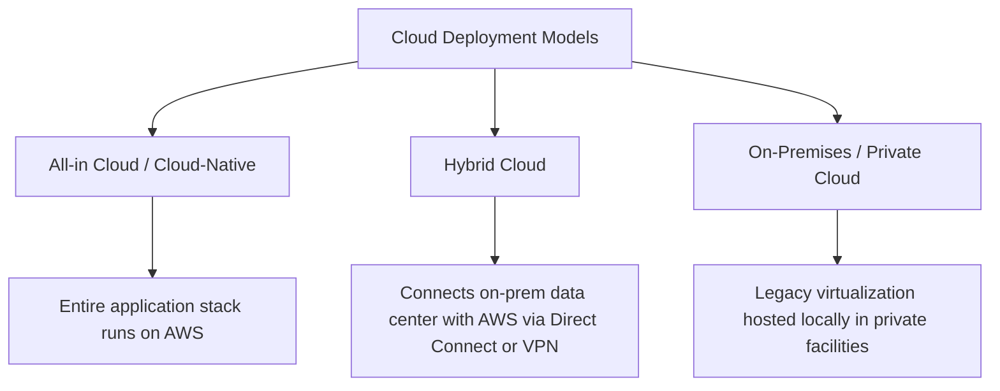
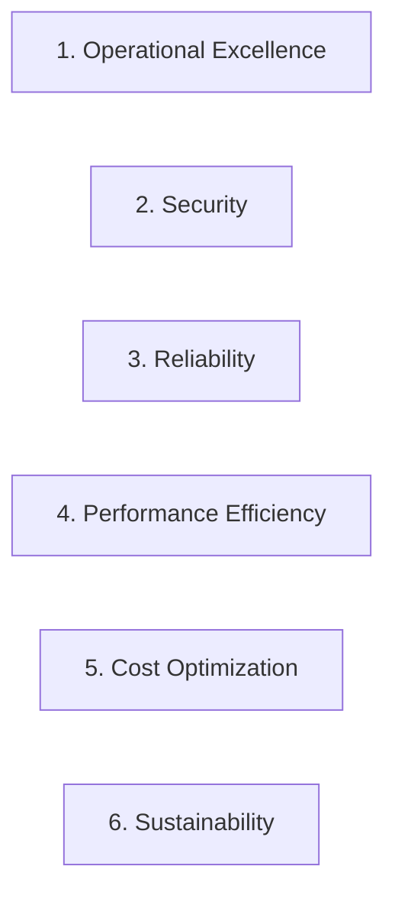
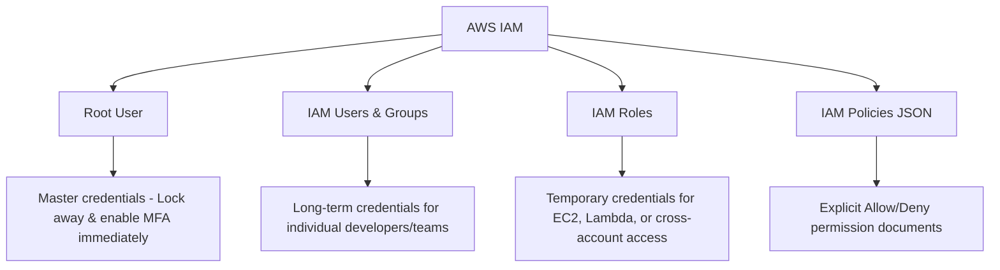
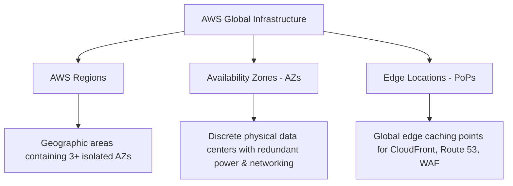
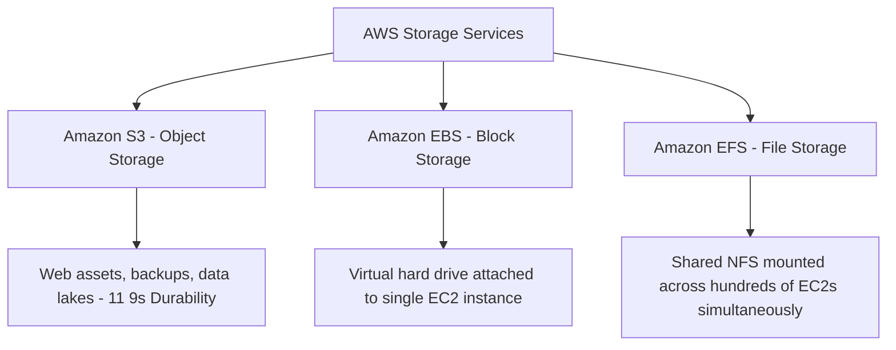

# ☁️ AWS Certified Cloud Practitioner (CLF-C02) — Master Preparation Guide & In-Depth Study Notes

Welcome to the official **AWS Certified Cloud Practitioner (CLF-C02)** master study guide created for the **AWS Student Builder Group**. This guide is designed to provide comprehensive, conceptual, and practical knowledge rather than superficial one-liners. Every service, architecture model, and security mechanism is explained with real-world context, technical mechanics, and key exam indicators to guarantee high confidence and mastery during the preparation exam.

---

## 📊 Exam Structure & Official Domain Breakdown

The AWS Certified Cloud Practitioner (CLF-C02) examination validates foundational, high-level understanding of the AWS Cloud, services, security models, architectural principles, and pricing structures.

| Domain | Focus Area | Exam Weighting | Core Knowledge Tested |
| :--- | :--- | :---: | :--- |
| **Domain 1** | **Cloud Concepts** | **24%** | Cloud value proposition, economics (CapEx vs OpEx), AWS CAF, Well-Architected Framework 6 pillars, 7 Rs of migration. |
| **Domain 2** | **Security & Compliance** | **30%** | Shared Responsibility Model, IAM identities & policies, encryption (KMS), network firewalls (SG vs NACL), audit & compliance (Artifact, CloudTrail, Shield, WAF). |
| **Domain 3** | **Cloud Technology & Services** | **34%** | Global Infrastructure (Regions, AZs, Edge Locations), Compute (EC2, Lambda, Fargate), Storage (S3, EBS, EFS), Databases (RDS, Aurora, DynamoDB), Networking (VPC, Route 53, CloudFront). |
| **Domain 4** | **Billing, Pricing, & Support** | **12%** | Pricing models (On-Demand, Spot, Savings Plans), billing tools (Cost Explorer, Budgets, Pricing Calculator), Consolidated Billing, AWS Support Plans (Basic to Enterprise). |

- **Exam Duration:** 90 Minutes (50 Questions in Live Exam Mode)
- **Passing Benchmark:** 700 / 1000 (Scaled Score ~70%)
- **Question Types:** Multiple choice (single best answer) & Multiple response (select two or more correct answers).

---

# 🏗️ DOMAIN 1: Cloud Concepts (24% of Exam)

---

### 1.1 What is Cloud Computing & The Cloud Value Proposition?
**Cloud Computing** is the on-demand delivery of IT resources (compute power, database storage, applications, and other IT assets) over the internet with **pay-as-you-go pricing**. Instead of purchasing, racking, and maintaining physical data centers and on-premises servers, organizations access technology services dynamically from Amazon Web Services (AWS).

#### The 6 Core Advantages of Cloud Computing (High Exam Frequency!)
1. **Trade Capital Expense for Variable Expense (CapEx to OpEx):**
   - *Traditional (CapEx):* Heavy upfront financial investments in physical hardware, real estate, cooling, and uninterruptible power supplies before running any software.
   - *Cloud (OpEx):* Pay only for what you consume on a variable operational model. Zero upfront capital commitment.
2. **Benefit from Massive Economies of Scale:**
   - Because AWS aggregates usage across hundreds of thousands of active customers worldwide, AWS achieves higher purchasing power and operational efficiencies, passing these savings back to customers as regular, automatic price reductions.
3. **Stop Guessing Capacity (Elasticity):**
   - Eliminates the risk of under-provisioning (which causes catastrophic application outages during traffic surges) or over-provisioning (which wastes capital on idle, unused servers). Cloud capacity expands and contracts automatically to match real-time load.
4. **Increase Speed and Agility:**
   - In a physical environment, ordering, delivering, and mounting a new server takes weeks or months. In AWS, developers can launch virtual servers, databases, and machine learning pipelines in **seconds to minutes** with simple API calls or console clicks, accelerating time-to-market.
5. **Stop Spending Money Running and Maintaining Data Centers:**
   - Organizations focus on what differentiates their business (building applications, serving users) rather than the "undifferentiated heavy lifting" of racking servers, patching hypervisors, and managing facility security.
6. **Go Global in Minutes:**
   - Easily deploy applications across multiple geographic AWS Regions and Edge Locations around the globe with single-digit millisecond latency for global end users.

---

### 1.2 Cloud Deployment Models

- **All-in Cloud (Cloud-Native):** The entire application is architected, hosted, and scaled inside AWS. It leverages serverless microservices, managed databases, and cloud-native object storage.
- **Hybrid Cloud:** Connects existing on-premises infrastructure with AWS cloud resources. Ideal for companies undergoing gradual migration, financial institutions requiring sensitive local data storage, or organizations with specialized on-premises hardware.
- **On-Premises (Private Cloud):** Legacy infrastructure managed in private data centers using virtualization tools (e.g., OpenStack, VMware). Involves high maintenance overhead and rigid capacity constraints.

---

### 1.3 Cloud Migration Strategies: The "7 Rs of Migration"
When organizations migrate on-premises workloads to AWS, they evaluate application portfolios using the 7 Rs:

1. **Rehost ("Lift and Shift"):** Moving applications to AWS without making any changes to application code or architecture. Fast, low-risk migration (e.g., copying virtual machines directly onto Amazon EC2).
2. **Replatform ("Lift, Tinker, and Shift"):** Making minor optimizations to achieve cloud benefits without changing core code (e.g., moving a self-managed MySQL database to Amazon RDS).
3. **Refactor / Re-architect:** Completely redesigning and rewriting an application into a cloud-native architecture (e.g., converting a monolithic app into serverless microservices using AWS Lambda and Amazon DynamoDB).
4. **Repurchase ("Drop and Shop"):** Replacing legacy software with a Software-as-a-Service (SaaS) platform (e.g., migrating on-premises CRM to Salesforce or HR systems to Workday).
5. **Relocate:** Moving hypervisor-level workloads (like VMware Cloud on AWS) without changing configurations or rewriting code.
6. **Retain:** Keeping applications in the on-premises environment because they were recently upgraded, have strict compliance boundaries, or are not ready for migration.
7. **Retire:** Decommissioning applications, servers, or legacy modules that are no longer needed or useful.

---

### 1.4 AWS Cloud Adoption Framework (AWS CAF)
The AWS CAF organizes guidance into **6 Perspectives** to help organizations create structured cloud transformation roadmaps:

- **Business Perspectives (Focus on Business Strategy):**
  1. *Business Perspective:* Ensures cloud investments align with business strategies, revenue goals, and digital transformation.
  2. *People Perspective:* Focuses on organizational change management, cross-functional training, culture evolution, and role transitioning.
  3. *Governance Perspective:* Focuses on program management, cloud financial management (FinOps), and measuring business value.
- **Technical Perspectives (Focus on Technical Execution):**
  4. *Platform Perspective:* Focuses on cloud architecture principles, infrastructure provisioning, and migration patterns.
  5. *Security Perspective:* Focuses on identity access controls, data confidentiality, compliance standards, and automated threat defense.
  6. *Operations Perspective:* Focuses on service health monitoring, operational excellence, incident response, and disaster recovery.

---

### 1.5 The AWS Well-Architected Framework (6 Pillars)

1. **Operational Excellence:** Focuses on running and monitoring systems to deliver business value, continually improving processes, and automating changes through code (*Infrastructure as Code via AWS CloudFormation*).
2. **Security:** Focuses on protecting data, systems, and assets through structured identity controls (*Principle of Least Privilege*), encryption at rest and in transit (*AWS KMS*), and automated threat detection (*Amazon GuardDuty*).
3. **Reliability:** Focuses on ensuring a workload performs its intended functions correctly and consistently, recovering automatically from infrastructure failures (*Multi-AZ redundancy, Auto Scaling, decoupled queues with Amazon SQS*).
4. **Performance Efficiency:** Focuses on selecting the most appropriate resource types, monitoring performance metrics, and evolving architectures as technologies advance (*Serverless, compute optimization*).
5. **Cost Optimization:** Focuses on avoiding unnecessary spending, matching capacity to demand (*Savings Plans, Spot Instances*), and analyzing spend over time (*AWS Cost Explorer*).
6. **Sustainability:** Focuses on minimizing the environmental and carbon impacts of running cloud workloads through right-sizing, eliminating idle capacity, and using energy-efficient AWS Graviton processors.

---

### 1.6 Key Reliability & Disaster Recovery Concepts
- **High Availability (HA):** Designing systems to operate continuously without human intervention or failure for extended periods, typically achieved by deploying redundant resources across multiple Availability Zones.
- **Elasticity:** The ability to dynamically acquire resources as demand increases and release them when traffic drops (eliminating wasted expenditure).
- **Scalability:** The ability of an architecture to handle growth in users, transactions, or data volume over time:
  - *Vertical Scaling (Scale Up/Down):* Adding more CPU/RAM to an existing single server instance.
  - *Horizontal Scaling (Scale Out/In):* Adding or removing multiple server instances to distribute load (recommended cloud practice).
- **Disaster Recovery Metrics:**
  - **RTO (Recovery Time Objective):** The maximum acceptable duration of system downtime before business operations must be restored.
  - **RPO (Recovery Point Objective):** The maximum acceptable amount of transactional data loss measured in time (e.g., losing up to 15 minutes of database writes).

---

# 🔒 DOMAIN 2: Security & Compliance (30% of Exam)

---

### 2.1 The AWS Shared Responsibility Model

Security and compliance is a shared partnership between AWS and the customer:

| Responsibility Layer | AWS Responsibility (*"Security OF the Cloud"*) | Customer Responsibility (*"Security IN the Cloud"*) |
| :--- | :--- | :--- |
| **Physical Facilities** | Data center biometric security, power, climate, physical server racks. | *None* (Customers have zero physical access to AWS data centers). |
| **Hardware & Virtualization** | Server motherboards, host hypervisors, disk drive destruction. | *None*. |
| **Network Infrastructure** | Global backbone fiber, edge location routers, physical switches. | **Security Groups**, **Network ACLs**, Subnet routing tables, VPC Peering. |
| **Operating System (EC2)** | Underlying hypervisor updates. | **Guest OS patching**, antivirus software, firewall daemon configs. |
| **Identity & Access** | IAM service infrastructure availability. | **IAM users, passwords, MFA**, access keys, permission policies. |
| **Data & Content** | Hardware security modules (KMS infrastructure). | **Data encryption at rest and in transit**, S3 bucket policies. |
| **Managed Services (S3, RDS)** | OS patching, DB engine version maintenance, hardware scaling. | **Access permissions**, database user credentials, table permissions. |

---

### 2.2 AWS Identity and Access Management (IAM)
**AWS IAM** is the core security service used to manage authentication and authorization for users, applications, and AWS resources.

#### Core IAM Building Blocks:
- **Root User:** Created automatically upon AWS account creation. Has complete, unrestricted access to all resources and billing.
  - *Exam Best Practice:* **Never use the root user for everyday tasks**. Lock away credentials, enable Multi-Factor Authentication (MFA), and create administrative IAM users or roles.
- **IAM Users:** Identity entities representing specific people or applications requiring long-term access.
- **IAM Groups:** Collections of IAM users. Attaching an IAM policy to a group grants those permissions to all member users.
- **IAM Roles:** Secure identities with specific permissions that do not possess static long-term credentials. They provide **temporary security credentials** and can be assumed by applications running on EC2 instances, Lambda functions, or users in other accounts.
- **IAM Policies:** Declarative JSON documents defining explicit `Effect` (`Allow` or `Deny`), `Action` (e.g. `s3:GetObject`), `Resource` (ARN of S3 bucket), and `Condition`.
- **Principle of Least Privilege:** Fundamental security best practice: users, applications, and roles should only be granted the minimum permissions necessary to complete their required tasks.
- **IAM Credential Report:** A downloadable CSV file auditing the status of passwords, access keys, and MFA enablement across all IAM users in the account.

---

### 2.3 Network Security: Security Groups vs. Network ACLs

| Feature | Security Group (SG) | Network Access Control List (NACL) |
| :--- | :--- | :--- |
| **Operational Level** | **Instance Level** (attached to EC2 network interface). | **Subnet Level** (guards entire VPC subnets). |
| **State Nature** | **Stateful** (Inbound return traffic is automatically allowed outbound regardless of rules). | **Stateless** (Inbound and outbound rules must be explicitly configured separately). |
| **Rule Types** | Supports **`Allow` rules only** (all other traffic is denied by default). | Supports explicit **`Allow` and `Deny` rules**. |
| **Evaluation Order** | All rules are evaluated simultaneously. | Evaluated in **numerical sequence** (lowest rule number processed first). |

---

### 2.4 Security, Threat Detection & Compliance Services

- **AWS WAF (Web Application Firewall):** Protects web applications from common Layer 7 web exploits (such as SQL Injection, Cross-Site Scripting [XSS], and HTTP request floods) by filtering incoming web traffic at CloudFront, ALB, or API Gateway.
- **AWS Shield:** Managed Distributed Denial of Service (DDoS) protection:
  - *Shield Standard:* Automatically protects all AWS customers against common Layer 3/4 network and transport DDoS attacks at no extra cost.
  - *Shield Advanced:* Paid enterprise tier offering 24/7 access to the AWS DDoS Response Team (DRT), financial cost protection against traffic surges, and Layer 7 protection.
- **Amazon GuardDuty:** Intelligent threat detection service that continuously monitors CloudTrail event logs, VPC Flow Logs, and DNS query logs using machine learning to detect compromised instances or unauthorized account access.
- **Amazon Inspector:** Automated vulnerability management service that scans Amazon EC2 instances, container images in ECR, and Lambda functions for software vulnerabilities and unintended network exposure.
- **Amazon Macie:** Data security and privacy service that uses machine learning and pattern matching to discover, classify, and protect sensitive data (such as Personally Identifiable Information - PII or credit card numbers) stored in **Amazon S3**.
- **AWS KMS (Key Management Service):** Managed service that makes it easy to create, manage, and rotate cryptographic encryption keys used across S3, EBS, RDS, and DynamoDB.
- **AWS Secrets Manager:** Securely stores, retrieves, and **automatically rotates** database credentials, API keys, and passwords on a scheduled basis.
- **AWS Artifact:** A self-service portal providing on-demand access to AWS's official compliance reports (e.g., SOC 1/2/3, PCI-DSS, ISO certifications) and security agreements.
- **AWS Organizations Service Control Policies (SCPs):** Centralized governance guardrails that enforce maximum permission boundaries across multiple AWS member accounts, even overriding member account root users.
- **AWS Security Hub:** A single pane of glass aggregating and prioritizing security alerts and compliance checks (against benchmarks like CIS AWS Foundations) across all AWS accounts.

---

# 💻 DOMAIN 3: Cloud Technology & Services (34% of Exam)

---

### 3.1 AWS Global Infrastructure

- **AWS Regions:** Geographic locations around the world (e.g., `us-east-1`, `eu-west-1`). Each Region is completely isolated from other Regions and contains **at least 3 Availability Zones**.
  - *Region Selection Factors:* Compliance / Data Residency laws, proximity to end users (latency), available services, and regional pricing differences.
- **Availability Zones (AZs):** One or more discrete physical data centers within a Region, equipped with independent power, cooling, and physical security, connected via ultra-low-latency fiber. Deploying across multiple AZs provides **Fault Tolerance** and **High Availability**.
- **Edge Locations (Points of Presence):** Hundreds of global edge endpoints used by **Amazon CloudFront** (CDN), **AWS Global Accelerator**, and **Amazon Route 53** to cache content closer to end users.
- **AWS Outposts:** Hardware racks delivered and installed in a customer's physical on-premises data center to run native AWS services locally for extreme low-latency or local data residency needs.

---

### 3.2 Compute Services

- **Amazon EC2 (Elastic Compute Cloud):** Infrastructure-as-a-Service (IaaS) virtual servers in the cloud with full control over the guest OS, networking, and software stack.
- **Amazon EC2 Purchasing Models (High Exam Frequency!):**
  - **On-Demand:** Pay-by-the-second compute with zero upfront commitment. Best for short-term, unpredictable workloads or development/testing.
  - **Savings Plans:** Commit to a consistent compute spend ($/hour) for a 1 or 3-year term in exchange for up to **72% discounts** across EC2, Fargate, and Lambda.
  - **Reserved Instances (RIs):** Commit to a specific instance configuration for a 1 or 3-year term for up to **72% discounts** (Standard or Convertible RIs).
  - **Spot Instances:** Bid on unused spare EC2 capacity at up to **90% discounts**. AWS can reclaim Spot instances with a 2-minute notification. Best for fault-tolerant, stateless, or batch processing jobs.
  - **Dedicated Hosts:** Physical EC2 server fully dedicated for customer use. Used to satisfy strict compliance regulations or server-bound software licenses (BYOL).
- **AWS Lambda (Serverless Compute):** Event-driven compute service that executes application code without provisioning or managing servers. Scales automatically and bills strictly per millisecond of execution time (zero cost when idle). Max execution duration: **15 minutes**.
- **Container Services:**
  - **Amazon ECS (Elastic Container Service):** Scalable container orchestration service for Docker containers.
  - **Amazon EKS (Elastic Kubernetes Service):** Fully managed Kubernetes engine.
  - **AWS Fargate:** Serverless compute engine for containers (works with ECS and EKS) eliminating the need to manage EC2 worker nodes.
- **AWS Elastic Beanstalk (PaaS):** Platform-as-a-Service for quickly deploying web applications (Java, Python, PHP, Node.js, .NET) where AWS manages provisioning, load balancing, and scaling while retaining full infrastructure access.

---

### 3.3 Storage Services Comparison

- **Amazon S3 (Simple Storage Service):** Scalable object storage storing data inside buckets with **99.999999999% (11 9's)** durability:
  - *S3 Standard:* High availability and millisecond latency for frequently accessed data.
  - *S3 Intelligent-Tiering:* Automatically moves objects between frequent and infrequent tiers based on access patterns without retrieval fees or operational overhead.
  - *S3 Standard-IA:* Lower storage cost for data accessed less frequently, but requiring immediate access when requested.
  - *S3 One Zone-IA:* Lower-cost storage for non-critical, reproducible data stored in a single AZ.
  - *S3 Glacier Flexible Retrieval:* Low-cost archival storage (retrieval within minutes to 3–5 hours).
  - *S3 Glacier Deep Archive:* Lowest-cost storage class in AWS, designed for 7–10+ year compliance retention (standard retrieval within 12 hours).
  - *S3 Versioning:* Preserves historical copies of objects every time they are modified, protecting against accidental deletions or overwrites.
- **Amazon EBS (Elastic Block Store):** Persistent block-level storage volumes attached directly to a single EC2 instance in the same AZ (behaves like a physical virtual hard disk). Supports point-in-time **EBS Snapshots** backed up to S3.
- **Amazon EFS (Elastic File System):** Fully managed shared Network File System (NFS) that can be mounted concurrently by hundreds of Linux EC2 instances across multiple AZs.
- **AWS Snow Family:** Physical ruggedized devices for offline, secure petabyte-scale data migration:
  - *AWS Snowcone (8 TB)* &rarr; *AWS Snowball Edge (80 TB)* &rarr; *AWS Snowmobile (100 Petabytes in a 45-foot shipping container)*.

---

### 3.4 Database Services

- **Amazon RDS (Relational Database Service):** Managed SQL database service supporting MySQL, PostgreSQL, MariaDB, Oracle, and Microsoft SQL Server with automated backups, patching, and scaling.
  - *Multi-AZ Deployment:* Synchronous standby replica in another AZ for **High Availability & automatic disaster failover**.
  - *Read Replicas:* Asynchronous replicas that offload read-heavy traffic from the primary database to enhance performance.
- **Amazon Aurora:** Cloud-native relational database compatible with MySQL and PostgreSQL, delivering up to **5x the throughput of MySQL** with automated 6-way storage replication across 3 AZs.
- **Amazon DynamoDB:** Fully managed, serverless **NoSQL key-value and document database** providing single-digit millisecond latency at any scale.
- **Amazon Redshift:** Fast, fully managed, petabyte-scale **cloud data warehouse** designed for complex SQL analytics, OLAP queries, and business intelligence.
- **Amazon ElastiCache:** Fully managed in-memory data caching service supporting **Redis** and **Memcached** to accelerate database query speeds.

---

### 3.5 Networking & Content Delivery

- **Amazon VPC (Virtual Private Cloud):** Logically isolated virtual network in your AWS account where you control IP addressing, subnets, route tables, and gateways.
  - *Public Subnet:* Connected to the Internet Gateway; instances have public IPs and are reachable from the internet.
  - *Private Subnet:* Isolated from direct incoming internet traffic; used for backend application servers and databases.
  - *Internet Gateway (IGW):* Enables two-way communication between VPC public subnets and the internet.
  - *NAT Gateway:* Enables private subnet instances to initiate outbound connections to the internet (for OS updates) while blocking unsolicited inbound internet traffic.
- **Amazon Route 53:** Highly available and scalable Domain Name System (DNS) service and domain registrar supporting flexible routing policies (Simple, Weighted, Latency, Failover, Geolocation).
- **Amazon CloudFront:** Fast Content Delivery Network (CDN) caching static and dynamic web content (HTML, CSS, images, videos) at global Edge Locations for ultra-low latency.
- **AWS Direct Connect:** Dedicated, private physical fiber-optic connection linking an on-premises data center directly to AWS, bypassing the public internet for consistent throughput.
- **Elastic Load Balancing (ELB):** Automatically distributes incoming application traffic across multiple targets (EC2 instances, containers, IP addresses) in multiple AZs.

---

### 3.6 Management, Monitoring & Application Integration

- **Amazon CloudWatch:** Monitors operational metrics, collects system logs, renders visual dashboards, and triggers automated alerts/alarms when thresholds (like CPU utilization) are breached.
- **AWS CloudTrail:** Audit logging service that records all **API actions, user logins, and console activity** across your AWS account (*"Who did what, from where, and when"*).
- **AWS Config:** Tracks configuration changes, resource relationships, and evaluates compliance history against desired configuration rules over time.
- **AWS CloudFormation:** Infrastructure as Code (IaC) service that models, provisions, and versions cloud resources consistently using JSON/YAML templates.
- **AWS Trusted Advisor:** Online advisory tool inspecting your environment in real-time across **5 pillars: Cost Optimization, Security, Fault Tolerance, Performance, and Service Quotas**.
- **Amazon SQS (Simple Queue Service):** Decoupled, asynchronous message queuing service allowing microservices and distributed systems to process jobs independently without message loss.
- **Amazon SNS (Simple Notification Service):** Managed Publish/Subscribe (Pub/Sub) messaging service that sends push notifications, emails, SMS, or triggers Lambda functions.
- **AWS Step Functions:** Visual workflow service coordinating distributed microservices and serverless functions into multi-step automated workflows with error handling.

---

# 💰 DOMAIN 4: Billing, Pricing, & Support (12% of Exam)

---

### 4.1 Cost Estimation, Visualization & Governance Tools

- **AWS Pricing Calculator:** Web tool used **before deployment** to estimate and model monthly infrastructure costs for planned architectures.
- **AWS Cost Explorer:** Visual analytics tool used **after deployment** to track, analyze, filter, and forecast AWS spending and usage trends for up to 12 months ahead.
- **AWS Budgets:** Allows setting custom spending and usage limits that trigger automated email or SNS alerts when actual or forecasted costs exceed defined thresholds.
- **AWS Organizations Consolidated Billing:** Combines billing across multiple AWS member accounts into a single bill, enabling aggregated usage volume discounts across services like S3 and EC2.
- **Cost Allocation Tags:** Custom key-value metadata labels attached to AWS resources to categorize and track costs by department, environment (dev/prod), or project in Cost Explorer.
- **AWS Marketplace:** A curated digital catalog where customers can discover, evaluate, purchase, and deploy thousands of third-party software applications and services that run on AWS.

---

### 4.2 AWS Support Plans Comparison (High-Yield Exam Matrix!)

| Support Feature | Basic Support | Developer Support | Business Support | Enterprise Support |
| :--- | :--- | :--- | :--- | :--- |
| **Monthly Cost** | **Free** | Starts at **$29/mo** | Starts at **$100/mo** | Starts at **$15,000/mo** |
| **Target Use Case** | All AWS accounts | Experimenting & Testing | Production Workloads | Business-Critical Workloads |
| **Technical Access** | Customer service & billing only | Email during business hours | **24/7 Phone, Chat, & Email** | **24/7 Phone, Chat, & Email** |
| **Authorized Contacts** | Unlimited | 1 Primary Contact | Unlimited Contacts | Unlimited Contacts |
| **Response SLAs** | N/A | General Guidance: <24h System Impaired: <12h | System Impaired: <12h Production Down: **<1 hour** | Business-Critical Down: **<15 minutes** |
| **Trusted Advisor** | Core Security & Quota checks (7 checks) | Core Security & Quota checks | **Full Access** (All 5 Pillars) | **Full Access** (All 5 Pillars) |
| **Technical Account Manager (TAM)** | No | No | No | **Designated TAM** (Dedicated technical advisor) |
| **Special Programs** | Documentation & Whitepapers | General architectural guidance | Contextual architectural guidance | **Infrastructure Event Management (IEM)** & Executive reviews |

---

# 🎯 Rapid Scenario Keywords & Exam Clue Matrix

When answering scenario questions, look for these definitive trigger phrases:

| Scenario / Need Description | Correct AWS Service / Feature |
| :--- | :--- |
| *Long-term compliance archive (7–10 yrs) at lowest cost* | **Amazon S3 Glacier Deep Archive** |
| *Automatic tiering without operational overhead or fees* | **Amazon S3 Intelligent-Tiering** |
| *Shared multi-instance Linux file storage via NFS* | **Amazon Elastic File System (Amazon EFS)** |
| *Block storage for a single EC2 virtual disk* | **Amazon Elastic Block Store (Amazon EBS)** |
| *Database with automatic synchronous Multi-AZ failover* | **Amazon RDS Multi-AZ Deployment** |
| *Offload heavy read traffic from relational database* | **Amazon RDS Read Replicas** |
| *Serverless NoSQL database with single-digit ms latency* | **Amazon DynamoDB** |
| *Sub-millisecond in-memory caching for database reads* | **Amazon ElastiCache** |
| *Petabyte-scale analytical data warehouse for SQL BI* | **Amazon Redshift** |
| *Audit trail of API activity / "Who did what and when"* | **AWS CloudTrail** |
| *CPU/RAM metrics, custom dashboards, and alarm thresholds* | **Amazon CloudWatch** |
| *Automated vulnerability scanning on EC2 & container images* | **Amazon Inspector** |
| *Intelligent threat detection monitoring VPC & DNS logs* | **Amazon GuardDuty** |
| *Discover and classify PII / sensitive data in S3* | **Amazon Macie** |
| *Layer 7 web filtering (SQLi, XSS, rate limiting)* | **AWS WAF** |
| *Layer 3/4 automated DDoS protection (Free default)* | **AWS Shield Standard** |
| *Dedicated physical fiber network bypassing the internet* | **AWS Direct Connect** |
| *Global edge caching for web assets and videos* | **Amazon CloudFront** |
| *Central permission guardrails across multi-account orgs* | **AWS Organizations Service Control Policies (SCPs)** |
| *Download official compliance audit reports (SOC, PCI-DSS)* | **AWS Artifact** |
| *Pre-deployment architectural cost estimation* | **AWS Pricing Calculator** |
| *Post-deployment spending analysis and 12-month forecasting* | **AWS Cost Explorer** |
| *Dedicated personal technical advisor in Support plan* | **Technical Account Manager (TAM) — Enterprise Support** |
| *Deepest discount (up to 90%) for fault-tolerant batch compute* | **Amazon EC2 Spot Instances** |

---

*Best of luck with your preparation exam and AWS certification journey! Review these notes, understand the architectural trade-offs, and master the cloud concepts.*
